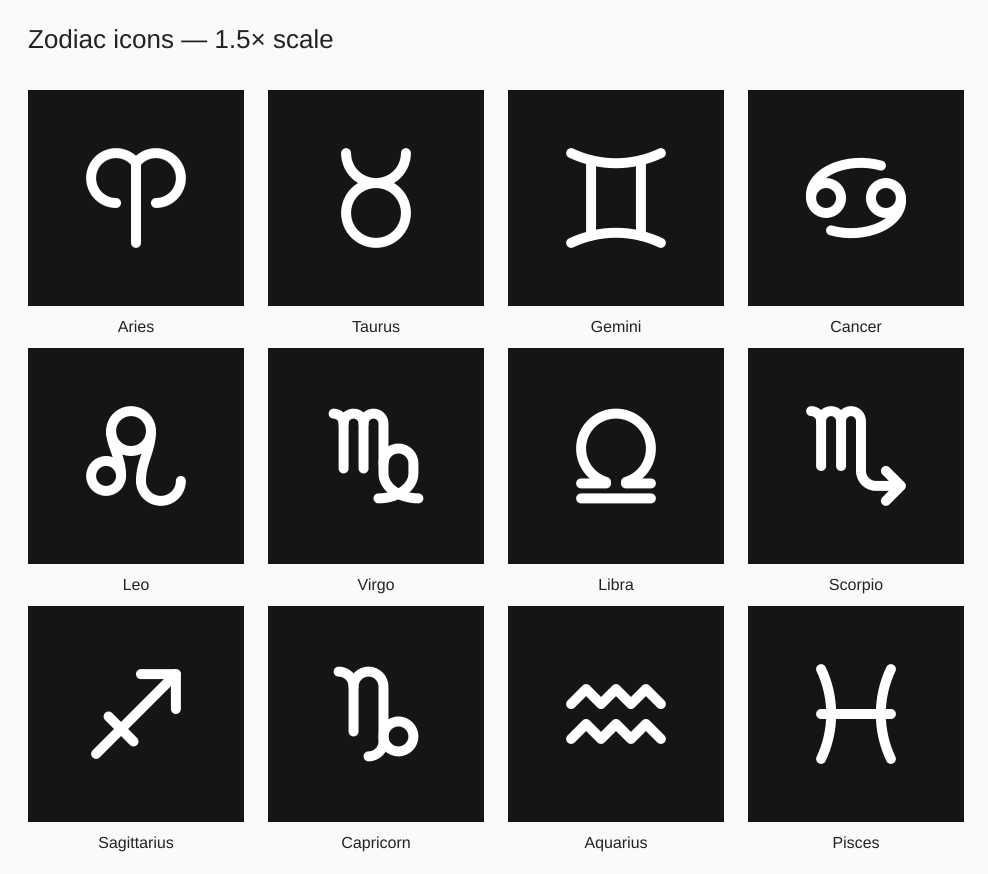
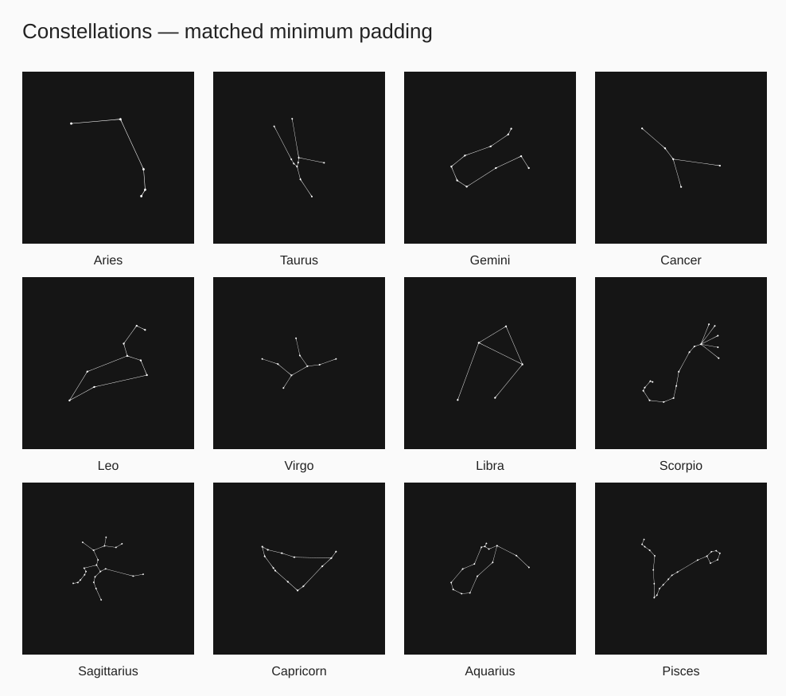

# Zodiac vector sets

Two complete sets of 12 square SVGs, built directly from the supplied paths:

- `icons/`: the exact supplied zodiac icon geometry, enlarged by **1.5×** relative to the previous reference composition.
- `constellations/`: the supplied constellation geometry, enlarged to match each corresponding icon's longest visible dimension and minimum edge padding.

Every file uses a **704 × 704** square canvas, the same plaque size as the previous reference compositions after removing their external white border. The background is matte black (`#151515`); the white vector artwork represents design openings. There are no raster images, generated photographs, external resources, or tracing approximations.

## Centering and scale

The previous icon occupied a 260-unit viewport mapped from a 24-unit source viewBox. The new scale is `260 × 1.5 / 24 = 16.25`, equivalent to a 390-unit viewport. Each icon retains its original paths and relative stroke width. The visible bounds include the round strokes, so centering does not depend on asymmetric empty space in the source viewBox.

The visible artwork's bounding-box center is **(352, 352)** in both sets. Each constellation is scaled uniformly: its proportions, paths, and original transforms are preserved.

“Matching padding” means **equal minimum edge padding in each corresponding icon/constellation pair**. Their longest visible dimensions match exactly. Different aspect ratios naturally leave different amounts of space along their shorter axes; the constellations are not stretched to force all four margins to match. Icons with different source bounds can also have different padding from other signs because their enlargement is exactly 1.5×, rather than individually normalized to a new size.

## Preview

### Icons



### Constellations



## Reproduce and verify

From the repository root:

```sh
node artifacts/zodiac-products/vector-sets/build.mjs
```

The generator uses the existing Playwright installation and `/usr/bin/chromium`. Set `ZODIAC_CHROMIUM` to use a different Chromium executable. It verifies all 24 saved SVGs in Chromium: painted bounds centered within 0.01 canvas units, exact icon enlargement, matching pair padding, unchanged source paths/transforms, and no embedded raster images. It also checks that source files have not changed.

`measurements.json` records all bounds, four individual margins, scales, and source hashes. The original source folders and earlier mockups remain available alongside this directory.

These SVGs are visual design assets. A production DXF still needs bridges, mounting details, material dimensions, and a cutting review.

The Tabler license notice is included in `TABLER-LICENSE.md`. Constellation paths come from the supplied local files.
