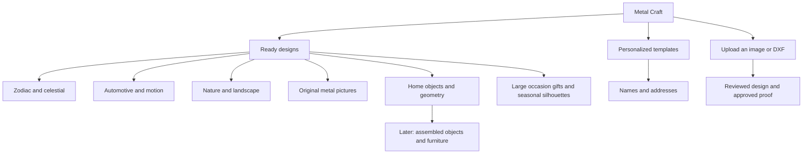

# Metal Craft — premade inventory direction

Planning draft · revised 10 October 2026 with owner-provided machine specifications and product measurements · Start here

**Metal Craft makes substantial decorative silhouettes, metal pictures, and occasion gifts from sheet metal, plus custom pieces made from customers' ideas.** The premade catalog should make these possibilities tangible through a recognizable collection of larger objects. Gifts can be large: the owner's example is a substantial stork-themed gift for a pregnant woman.

These documents propose products; they do not record approved CAD, manufactured stock, or established prices. The [owner's product reference](production-scale-reference.md) is a manufactured cutout measuring **300 mm wide × 600 mm high**, with approximately **2–2.5 mm** sheet thickness; exact gauge and material remain unconfirmed. Other numerical concept dimensions remain proposals, not measurements inferred from the shirt. The existing online shop is empty according to the [setup record](../metal-craft-setup-2026-10-10.md); that does not mean the workshop has never made products.

## Confirmed scale direction

- The main offer is larger metal artwork and substantial occasion gifts, using the measured maternity gift as the reference.
- Medallions, bookmarks, tiny ornaments, and miniature accessories remain outside the proposed core assortment because the owner prefers the economics of larger products.
- The owner has since consulted technical staff: detailed small objects are feasible. The earlier shuriken/kunai size comparison is superseded as a supposed machine floor.
- Small items may be considered when their job economics justify them; they are not automatically rejected as uncuttable.
- Overall size and internal feature size remain separate. Lettering, gaps, feather details, bridges, and tips need validation for the actual material, thickness, and setup.

## Read the plan

**Latest zodiac direction:** square or circular products with a 1:1 bounding box, exact centered Tabler zodiac glyphs, and the owner's corresponding constellation SVGs. This replaces the earlier natural animal-shaped zodiac outline proposals. The first image set uses square plaques. See the [zodiac imagery brief](../../artifacts/zodiac-products/BRIEF.md) for source assets and generation status.

| Document | What it answers |
| --- | --- |
| [Laser machine specifications](../laser-machine-specs.md) | Current capacity, December 2026 incoming machine, measured product, and small-detail clarification. |
| [Product concept catalog](product-concepts.md) | What exactly could we sell? Twenty-four families with appearance, dimensions, finish, construction, and release conditions. |
| [Actual product and scale reference](production-scale-reference.md) | What did the owner show, what does it establish, and how does it change the inventory? |
| [Visual direction and sketches](visual-direction.md) | What should the objects look like together? Markdown sketches, positive/negative-space examples, and display scenes. |
| [Rights and custom-order boundaries](rights-and-custom-boundaries.md) | Which ideas can enter the catalog, which need permission, and how should uploads be treated? |

## Three ways to buy

| Offer | Customer chooses | Design work | Inventory implication |
| --- | --- | --- | --- |
| Ready designs | An existing design, a validated size, and an available finish | Already completed by Metal Craft | Can be stocked or made to order; label the actual availability. |
| Personalized designs | A ready template plus a name, address, date, or short message | A bounded change to a template, followed by a proof | Usually made to order. Each text layout still needs checking. |
| Custom projects | An image or DXF, dimensions, intended use, and finish preference | Conversion or CAD review, manufacturability review, and a customer-approved proof | A quoted job; never automatically counted as a reusable catalog design. |

“Premade” here means the **design is ready**. It does not mean the physical object is already on a shelf. “In stock” should be reserved for a counted finished item that can actually be shipped.

## The proposed collections

The initial visual identity: **substantial silhouettes, readable cutout detail, integrated messages where appropriate, and bridges that belong to the drawing.** Freestanding outlines can express the subject without putting every design into a circle or square frame. Occasion gifts and home artwork share the same substantial scale.

## First six prototypes

These six families are marked **P0** in the catalog. Prototype one design, one size, and one finish from each before expanding variants.

| Prototype | First proposed version | Why it belongs | Main thing to learn |
| --- | --- | --- | --- |
| MC-GIFT-01 · New Beginnings | Existing reference: 300 mm wide × 600 mm high; approximately 2–2.5 mm thick | Directly grounded in an item the workshop has already made | Confirm exact gauge, alloy, details, finish, and packaging before defining the ready product |
| MC-ZOD-01 · Zodiac animal and symbol silhouettes | Original Leo lion, proposed 650 × 450 mm, matte black | A substantial personal gift; a route to twelve signs | Whether each sign has a strong silhouette and reliably cut detail |
| MC-AUTO-01 · Canyon Coupe | Proposed 800 × 300 mm, matte black | Makes the sports-car idea real through an invented vehicle | Whether the long silhouette stays flat and ships without bending |
| MC-NAT-01 · Ridge at Dawn | Proposed 650 × 400 mm, matte black | Broad landscape appeal; an immediately legible metal picture | Whether openings, mounting, and wall shadow work together |
| MC-NAT-02 · Olive Branch | Proposed 650 × 350 mm, matte black | A substantial organic counterpoint | Whether leaf tips and stems survive finishing and handling |
| MC-ART-02 · Quiet Vase | Proposed 500 × 700 mm, matte black | Tests the “painting turned into metal” category using our own composition | Whether cutout translation reads like an image from across a room |

**First release target: six listings with one validated design each.** The zodiac silhouette family eventually contains twelve sign designs, but the other eleven are separate CAD and prototype approvals. They are not automatically ready because Leo works. The photographed maternity gift is the production reference, not evidence that every proposed design is already ready. If a prototype fails, fix or hold it.

### Then expand deliberately

1. Complete the remaining zodiac signs using the validated visual grammar. Each sign needs a cuttable drawing, not merely a renamed version of Leo.
2. Add P1 designs that reuse proven material, finish, mounting, and packaging choices. The catalog contains twelve P1 families.
3. Introduce the six P2 families only after the required outdoor finishing, bending, assembly, or functional testing is available.
4. Develop chairs as a separate furniture project after load-bearing design and manufacturing capability are established.

This is a sequencing recommendation, not a sales forecast. Early demand should decide which families get more stock.

## What the machine establishes — and what we still need to learn

Known from the owner: the current laser cutter follows DXF paths and accepts up to **1,500 × 3,000 mm** sheets, with maximum thicknesses of **12 mm steel** and **4 mm aluminium**. The incoming machine is expected in **December 2026**, accepting up to **2,000 × 4,000 mm**, with maxima of **20 mm steel** and **12 mm aluminium**. See the [central specifications](../laser-machine-specs.md); incoming capacity is not yet available production capacity.

Technical staff reportedly confirmed small detailed cuts are feasible. Larger decorative pieces remain the commercial priority because the owner reports small products have low profit margins. Painting and shipping are part of the intended offer.

Still unconfirmed: exact alloys/grades and stock availability, usable cutting margins, kerf, minimum reliable features by material/thickness, hole quality, dimensional tolerance, edge finishing, coating process, bending/welding access, mounting hardware, packing limits, and production time.

Use the successful 300 × 600 mm photographed piece as the manufacturing reference, with approximately 2–2.5 mm thickness pending gauge confirmation. Do not assign it a material or universal thickness for the entire catalog. Machine maximum thickness is a capacity ceiling, not a product recommendation. Functional pieces need their own thickness and stiffness decisions. Do not assume engraving, laser marking, bending, welding, or powder coating is available just because cutting is available.

Calling these objects “carvings” is understandable, but the product description should usually say **laser-cut metal wall art** or **metal cutout**. A through-cut does not create the tonal shading or surface relief of a carved painting.

## Keep the first assortment manageable

| Decision | Initial recommendation |
| --- | --- |
| Material | One tested material and thickness per family |
| Finish | Matte black first, using a confirmed coating process; add warm white or muted bronze-color coating after samples |
| Sizes | One validated size at release; validate a second size later |
| Detail limits | Record minimum reliable bridges, holes, gaps, and letter features separately from overall product size |
| Mounting | A proven mounting arrangement designed into the CAD; describe what hardware is supplied |
| Photography | Actual approved prototypes, a scale view, and an edge/mounting detail |
| Stock | One display sample per prototype; finished stock quantities depend on real demand and capacity |
| Packaging | Protect tips and openings; support the whole sheet shape against bending; verify the package with a sample |
| Personalization | A separate template offer with an approved proof; avoid unlimited options on every ready product |

A hypothetical six-family collection with two sizes and three finishes already creates **36 combinations**. Adding twelve zodiac designs multiplies the complexity. Start with the smallest useful assortment and expand where it earns its place.

## The release gate for each actual product

- [ ] Original artwork or a documented right to manufacture, adapt, sell, and market it; see [rights boundaries](rights-and-custom-boundaries.md).
- [ ] Correct units, intended dimensions, and a production-ready DXF reviewed by the operator.
- [ ] Stable retained metal, no accidental loose islands, and validated bridges, openings, holes, and edge distances.
- [ ] A finished sample that meets the intended appearance and handling requirements.
- [ ] Validated mounting or assembly, measured mass, and appropriate instructions.
- [ ] Real finish description, care instructions, and indoor/outdoor classification.
- [ ] Packaging that protects the actual product; recorded package dimensions and shipping weight.
- [ ] Measured production cost, approved price, and realistic lead time.
- [ ] Photographs of the item being sold and a clear account of what is included.
- [ ] Stock or made-to-order status entered accurately.

## Cost before price

Do not invent retail prices before samples exist. Record material usage including the allocated waste from nesting, cutting time and setup, deburring, finishing, hardware, assembly, packaging, design amortization, and expected rejects/rework. Add applicable selling/payment costs and delivery allocation consistently.

For a target margin on net sales, a useful starting calculation is:

`net selling price = allocated unit cost / (1 - target margin)`

This assumes the allocated unit cost already captures the costs being covered; percentage-of-sale fees need to be included consistently in the calculation. A margin and a markup are different. Taxes, delivery charges, and final customer price need the merchant's actual settings.

## What success should look like

The catalog feels like one workshop's collection: a substantial maternity gift, a zodiac silhouette, an original sports-car silhouette, a botanical piece, a landscape, and a metal picture share a coherent finish and level of craftsmanship. Custom work then feels like a natural extension: **“Choose one of our designs, or bring an idea for us to turn into metal.”**
