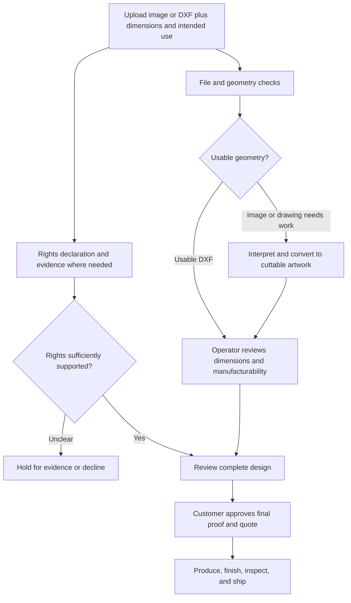

# Metal Craft — rights and custom-order boundaries

Catalog planning rules · researched 10 October 2026

The proposed [24 product families](product-concepts.md) use original compositions. This document defines a conservative catalog policy and a practical review process; it does not clear any finished drawing or decide a specific infringement dispute. Selling territories are not yet confirmed. The EU material below is relevant if the shop sells into the EU, and territorial review may differ elsewhere.

## The legal distinction that matters

Copyright concerns the particular artwork, not merely the broad idea. WIPO explains that ideas are distinct from protected expression and that using protected works generally requires authorization, subject to applicable exceptions. An online image is not automatically public domain. Tracing or converting it to DXF does not establish permission. [WIPO copyright FAQ](https://www.wipo.int/en/web/copyright/faq-copyright).

Other rights can also matter. Trademarks can include symbols and distinctive product shapes, while EU design protection concerns product appearance. Therefore the source picture, the depicted brand, and the depicted product design may need separate review. [WIPO trademarks](https://www.wipo.int/en/web/trademarks/), [EUIPO design FAQ](https://www.euipo.europa.eu/en/help-centre/design/faq-basic-questions).

**Our catalog policy:** choose independently developed designs with documented provenance. Hold recognizable third-party material for documented authorization and, where needed, qualified review. These are operating choices for Metal Craft, not a declaration that every depiction of every branded object is unlawful.

## What enters the premade catalog

| Proposed subject/source | Catalog decision | Required evidence or boundary |
| --- | --- | --- |
| Original botanical, landscape, geometric, or abstract art | Preferred | Creator, source drawing, revisions, and rights agreement if commissioned |
| Traditional zodiac ideas and astronomical facts | Preferred with our own execution | Original arrangement/glyph drawing; check any font or icon source |
| Invented sports-car silhouette | Preferred after comparison review | Independent sketches; no borrowed recognizable model, logo, or livery |
| Original still life or fictional portrait | Preferred | Our composition, rather than a trace of an artist's print or a celebrity photograph |
| Original stork, maternity, wedding, or family composition | Preferred | Draw the common theme independently; record the photographed example's artwork source before catalog reuse |
| Traditional seasonal themes | Preferred with our own execution | Independently drawn snowflake, tree, or star; no copied artwork |
| Third-party DXF bought online | Hold until license review | Permission for commercial physical products and adaptations; any quantities, territories, attribution, or file-sharing restrictions |
| Licensed clipart or stock photograph | Hold until license review | Check the exact asset and whether derivative merchandise use is covered; “royalty-free” alone is insufficient evidence |
| Historical painting or image labeled public domain | Hold until territorial/source review | Identify the exact work, version, creator, source reproduction, and supported rights status |
| Real vehicle model, badge, racing livery, or team crest | Excluded from the initial collection | Develop only with an adequate documented rights basis and review |
| Disney or other recognizable entertainment characters | Excluded from the initial collection | No unlicensed character designs, variants, or silhouettes |
| Another metal shop's silhouette or product design | Excluded as a source to copy | Create our own design from a broad theme instead |
| Customer-uploaded artwork | Custom review only | Customer's authority to use it; separate permission before catalog reuse |

The policy covers descriptions and marketing as well as the cut file. Do not use a character or brand name to sell a lookalike design, including in tags, filenames shown publicly, product titles, or promotional images.

## Automotive designs

Keep the sports-car category, but make it a Metal Craft design category:

1. Sketch a new vehicle using broad automotive ideas such as a low roof, broad wheels, and motion.
2. Design the proportions, body contours, lights, openings, and graphic treatment independently.
3. Compare the drawing with likely real-world references. A recognizable borrowed front end or body silhouette goes back for redesign or review.
4. Use a descriptive working title such as Canyon Coupe. Check naming before release and avoid model names, brand badges, distinctive racing graphics, and claims of affiliation.
5. Save drafts and creator records. Removing a logo or changing an arbitrary percentage of a source drawing is not our clearance method.

If an exact vehicle replica becomes important commercially, treat it as a separate rights-reviewed project. A customer's ownership of the physical car is not evidence that they can license every right involved in its depiction.

## Painting adaptations

The first collection should use **original art designed for metal**: Quiet Vase, Orbit, Tide Lines, and Two Faces. This avoids making historical or modern paintings the foundation of the launch.

For a later historical-art collection, document the exact artwork and relevant territories, establish the underlying work's rights status, and review the chosen reproduction/source terms. A public-domain label should be supported rather than assumed from age, a search result, or a US-only date rule. WIPO notes that copyright duration varies by national law. [WIPO copyright FAQ](https://www.wipo.int/en/web/copyright/faq-copyright).

For a living artist's work, obtain a written agreement covering the metal adaptation, commercial manufacture, sales, territories, marketing, credit, and any approval requirements. Paying for a picture or commissioning a drawing is not our substitute for documenting those rights.

## Third-party licenses

Creative Commons licenses differ: BY requires attribution; SA adds sharing conditions for adaptations; NC does not authorize commercial use; ND does not authorize sharing adaptations. Converting artwork into cuttable metal may involve adaptation, so verify the particular use and license. [Creative Commons license overview](https://creativecommons.org/cc-licenses/).

| Label | Metal Craft handling |
| --- | --- |
| CC0 or documented public domain | Check provenance and remaining rights; record evidence |
| CC BY | Review permitted use; implement required credit and change notices |
| CC BY-SA | Hold until adaptation and sharing obligations are understood and workable |
| Any NC license | Do not use for products sold commercially under that license |
| Any ND license | Do not assume it permits a shared metal adaptation; seek separate permission |
| Commercial asset license | Read merchandise/adaptation permissions, attribution, limits, and territory terms |
| No clear license | Hold; obtain permission or use an independently created design |

CC licenses do not grant all possible rights: third-party trademark, privacy, and personality rights can remain relevant, and the uploader may lack authority over included content. [Creative Commons FAQ](https://creativecommons.org/faq/index.html).

For fonts, review the specific font license and the intended lettering/modification workflow. A typeface being available to download is not our proof of permission. Save the license version with the design record.

## A rights record for every approved design

Use a Markdown record when developing actual artwork. This template is intentionally unfilled; the concept catalog has no cleared designs yet.

```markdown
# Design rights record — [family / artwork / revision]

- Status: draft / held for evidence / approved for specified use
- Creator and creation date:
- Original drawing and revision references:
- Source assets, URLs, and authors:
- License or agreement reference and version/date:
- Permission for adaptation and commercial physical products:
- Permission for listing images and marketing:
- Territories, quantities, duration, or other limits:
- Required attribution and change notices:
- Trademark/design/personality-rights review, where relevant:
- AI assistance and reference materials, if used:
- Reviewer, review date, and unresolved questions:
- Approved CAD revision and permitted catalog variants:
```

AI generation is not a shortcut around this record. Avoid prompting for protected characters or replicas and review results for recognizable borrowed elements. Keep source and revision history whichever tools the designer uses.

## How custom uploads connect to the ready catalog

The intended customer experience can remain simple: upload, enter dimensions, choose a finish, review a proof, and order. The workshop workflow behind it needs two distinct reviews: **technical feasibility and authority to reproduce the design**. Passing one does not pass the other.



This is a future workflow proposal, not an implemented upload or conversion service. Automatic checks can help triage files and geometry; they cannot reliably establish all rights or guarantee that an image becomes a manufacturable DXF without review.

### Inputs worth collecting

| Input | Why the workshop needs it |
| --- | --- |
| Image or DXF | Starting design; keep the original distinct from the production drawing |
| Desired width and height, with units | Establish scale and resolve aspect-ratio/cropping decisions |
| Size/detail feasibility | Use actual material/thickness and sample-confirmed feature limits; small detailed cuts are reportedly feasible, so do not enforce the earlier rough lower-size comparison as a cutoff |
| Quantity | Changes nesting, cost, and production planning |
| Intended use and placement | Determines whether a wall decoration, exterior sign, or functional part needs different review |
| Material/finish preference | A preference to confirm against workshop capabilities |
| Mounting or assembly expectation | Makes holes, supports, and included parts part of the design |
| Authority to reproduce, with evidence for third-party material | Provides a basis for rights review rather than an ownership assumption |

Keep the declaration concise: the customer confirms that they own or are authorized to reproduce and adapt the supplied material for the requested manufacture. That declaration is an input, not automatic approval when the image plainly depicts a protected character, logo, or another seller's artwork.

### Checks and decisions

- **Automated technical triage:** allowed file formats and sizes, safe parsing, DXF units/extents, missing or open contours, duplicate paths, tiny details, and potential disconnected retained areas. File acceptance is not production approval.
- **Image conversion review:** confirm silhouette/stencil interpretation, bridges, loss of shading, final proportions, and cut versus non-cut features. Do not promise a perfect one-click conversion of every photograph.
- **Rights review:** flag recognizable brands, characters, copied product artwork, unclear licenses, and uncertain sources. Hold for evidence or decline where authority cannot be established.
- **Customer proof:** show the actual intended cut geometry, dimensions, finish, and mounting/assembly arrangement. Approve this before manufacturing, including any conversion simplifications.
- **Workshop approval:** confirm material, thickness, tolerances, feature limits, safe handling, and feasibility for the intended use. Functional furniture requires a different review from decorative wall art.

### Custom work does not automatically become inventory

A customer may authorize one manufactured item without authorizing resale of the drawing or publication of personal imagery. Obtain separate permission for portfolio use, and a separate adequate agreement before reusing a design in the premade catalog. Keep customer files controlled and define an actual retention/deletion policy before launching uploads.

## Practical examples

| Request | Proposed decision |
| --- | --- |
| “Make an original Leo wall piece.” | Develop a substantial original lion silhouette; record the drawing and validate its cut geometry |
| “Make a large maternity gift like your photographed example.” | Confirm the existing drawing's provenance and measured specification; review any changed text or new drawing before production |
| “Make a low sports coupe for my garage.” | Offer the original Canyon Coupe, or develop a separately reviewed custom design |
| “Trace this exact branded sports-car promotional photo.” | Hold for review of the photo and depicted rights; do not clear it merely by deleting the badge |
| “Put this recognizable Disney character on sale in your ready collection.” | Exclude from the initial catalog; no manufacture or listing without an adequate documented rights basis |
| “Turn my own plant drawing into a metal picture.” | Review the customer's authority, conversion, and proof; no automatic resale or portfolio permission |
| “I bought this DXF, so make fifty products.” | Review its exact commercial manufacture license and limits first |
| “Copy this metal wall decoration from another shop.” | Decline copying; offer an independently designed interpretation of the broad theme |

The product opportunity remains broad: zodiac, vehicles, landscapes, original pictures, geometry, gifts, assembled objects, and eventually furniture. Original design makes those possibilities a distinctive Metal Craft collection.
