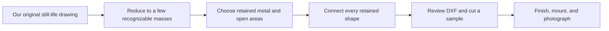

# Metal Craft — visual direction in Markdown

Companion to the [product concepts](product-concepts.md) · revised 10 October 2026 with measured scale and small-detail clarification

These are **concept sketches**, not cut files, fabrication drawings, dimensionally accurate previews, or photographs. They communicate composition and assortment using only Markdown. Letter symbols and thin strokes in the sketches stand for shapes that must become substantial connected metal in the actual CAD.

The [manufactured maternity gift beside a shirt](production-scale-reference.md) is the real visual reference. The owner has supplied its measurements: **300 mm wide × 600 mm high**, approximately **2–2.5 mm thick** with exact gauge unconfirmed. These values come from the owner, not from estimating the shirt. Small detailed cuts are reportedly feasible; substantial presence remains the collection's commercial focus.

## A coherent collection

The visual promise: **a substantial metal silhouette or scene, with readable internal cutouts and an expressive subject.** Gift themes can be as important as room decoration. The cuts should feel deliberate. Bridges should belong to the artwork. Mounting should look considered rather than added after the design is finished.

| Element | Direction | Avoid |
| --- | --- | --- |
| Silhouette | Readable from across a room | Detail that only reads in a close-up |
| Scale | Substantial artwork and occasion gifts, guided by the actual product | Miniature accessories or shrinking every drawing to an arbitrary size |
| Open areas | A few generous windows and channels | Dense perforation without a clear image |
| Connections | Stems, ridges, rims, and intersections that support the art | Random bars added across the subject |
| Finish | Matte black first; warm white and muted bronze-color coating later | Calling a bronze-colored steel piece “solid bronze” |
| Edges | Finished edges and intentionally softened exposed tips | Fragile points that catch fingers or packaging |
| Wall relationship | Some pieces close to the wall; selected pieces offset with validated hardware | Promising a specific shadow under every lighting condition |
| Composition | Subject-shaped outlines, wide scenes, and selected large framed/abstract pieces | Forcing subjects into medallions, badges, or small tiles |

The first collection should alternate dense and airy designs. New Beginnings is an expressive large gift; Leo has a natural animal silhouette; Quiet Vase is a picture-like panel; Olive Branch leaves more wall exposed; Canyon Coupe is wide and directional. That variety makes the catalog feel creative while the material and finishing tie it together. Large abstract Orbit follows in P1.

## First-release contact sheet

The zodiac thumbnail below records the earlier animal-silhouette proposal. The owner has since selected square/circular 1:1 plaques with a centered exact Tabler glyph plus the supplied constellation. Use the [active zodiac brief](../../artifacts/zodiac-products/BRIEF.md) for the new image set rather than this earlier thumbnail.

```text
       LEO ZODIAC SILHOUETTE               CANYON COUPE
         / broad mane \                _________
        /  lion profile \          ___/         \____
        |  open details |         /__  ___    ___   __\
         \_____________/             (___)==(___)
         subject-shaped           =====================
         no badge frame            wide, low, connected

         RIDGE AT DAWN                     OLIVE BRANCH
       +----------------+                  ()   ()
       |       (sun)    |                   \\  //  ()
       |   /\____/\     |             ()=====\\//==//
       |__/  \__/  \____|                    //
       +----------------+                  ()   ()
        framed, open sky                broad stem + leaves

          NEW BEGINNINGS                     QUIET VASE
       [broad wing/body]                   +---------------+
                 \____ [head]---           |    ()   ()    |
                       \                   |     \\ //     |
                     [bundle]              |    /====\     |
                     [message]             |    |    |     |
       large connected stork gift          |====\____/=====|
                                           +---------------+
                                             original still life
```

The mane details, stork/bundle connection, and message above are schematic. In the CAD, they must become reliably cut connected shapes. The coupe wheels attach to the retained lower structure. The landscape sun attaches to a ridge or designed bridge. These choices determine whether the image can actually exist as one cut piece.

## The occasion-gift direction

The photographed item is substantial and gift-wrapped. That changes the merchandising idea: the buyer is choosing a memorable object for an occasion, not necessarily a small add-on.

```text
ACTUAL REFERENCE                   PROPOSED FOLLOW-ON THEMES

stork + bundle, 300 W x 600 H mm    mother and child silhouette
integrated message                 connected wedding pair
protective backing                 large family-tree composition
gift wrapping / ribbons            substantial new-home gift

Each new drawing needs its own scale, cut-detail, and rights review.
```

Let the subject determine the contour. For a ready design, the message is fixed and already validated. For a personalized version, show the customer a proof and check every altered letter/bridge at the selected size.

## Think in retained metal and openings

For these wall-art concepts, the black shape usually comes from coated retained metal. The lighter shape comes from the wall seen through the cuts. It is not a two-color print.

```text
SCHEMATIC CROSS-CUT THROUGH A LETTER-LIKE OPENING

Disconnected center                    Connected center

###########                            ###########
###.....###                            ###.....###
##..###..##                            ##..###..##
##..###..##                            #######..##
##..###..##                            ##..###..##
###.....###                            ###.....###
###########                            ###########

The central metal island falls         A deliberate retained-metal bridge
out when surrounded by cuts.           links the center to the outer plate.

# = retained metal       . = opening/cut-away area
```

This is the same problem in the center of an O, a wheel, a sun, a flower, or a face. Three design responses are useful:

1. **Connect it:** add a substantial bridge, stem, spoke, ridge, or frame connection.
2. **Make it an opening:** a star can be a hole through a connected band instead of a floating metal dot.
3. **Design an assembly:** mount separate pieces to a backing or join layers deliberately, with additional parts and cost. Keep that out of the simplest first release.

A connected drawing can still be too flimsy. Geometry must pass physical sampling, not just a visual connectivity check.

Small detail is technically possible according to the owner's consultation with technical staff. Keep overall size, minimum retained bridge, minimum hole, minimum spacing, and minimum text feature as separate fields. The operator should use successful samples to establish them for each material/thickness; do not impose the earlier rough lower-size comparison as a universal limit. Larger objects are prioritized for their commercial potential, not because small drawings are inherently uncuttable.

## What “painting in metal” means



For Quiet Vase, imagine a tall frame with an open upper half, a broad vase in the lower half, and leaves joined to a strong stem. The table band connects the vase to the frame. A half-circle background can be partly solid and partly open so it adds balance without becoming a loose island.

The visual result should resemble a graphic original painting. A photo with gradients cannot retain all its tones as a single through-cut silhouette. It needs interpretation: fewer shapes, stronger contours, and deliberate bridges. Engraving or layered construction would be different products with different requirements.

## The expanded catalog at a glance

| Collection | Visual range | How it differs from the first prototypes |
| --- | --- | --- |
| Zodiac | Large original sign subject → large bold glyph | Personal identity through two different substantial silhouettes |
| Automotive | Wide coupe → open roadster → tall top view | Invented vehicle designs, changing orientation and character |
| Nature | Mountain picture → branch → forest → bird → honeycomb | Landscape, organic silhouette, and geometric nature art |
| Metal pictures | Arcs → still life → waves → abstract profiles | A route from simple abstraction to figurative artwork |
| Home | Arch plaque → lattice → address sign → key rail | Decorative pieces first, personalization and function later |
| Occasion and seasonal gifts | Stork/bundle → later family themes → large winter scene | Substantial decorative objects with gift presentation |
| Later objects | Garden screen → slotted bird → bookends → table | More scale, assembly, outdoor use, or functional demands |

## Proposed display scenes

### A personal gift wall

```text
       [ large Leo silhouette ]   [ another sign silhouette ]
            natural outline            natural outline

                 narrow console
         --------------------------------
```

Two substantial zodiac silhouettes can suggest a couple or family without relying on a licensed character. Coordinate their visual presence and finish; different natural outlines need not have identical width and height. A name/date variant can be developed later as a personalized template.

### An automotive corner

```text
               CANYON COUPE — proposed 800 mm wide
             _____________________________

           shelf / desk / workshop surface
         ===================================
```

The wide shape feels intentional above a horizontal surface. Show enough room around it to communicate scale, and include a close-up of the wheel connections and mounting arrangement. Use a neutral setting without visible third-party branding.

### A quiet dining wall

```text
       QUIET VASE                       OLIVE BRANCH
       proposed 500 x 700              proposed 650 x 350
      +-----------+                     airy shape
      |           |                  /  /  /  /  /
      | still life|
      +-----------+

                  dining / console surface
          ------------------------------------
```

Pairing a dense framed picture with an airy branch shows that the collection is more than silhouette badges. The scene is a merchandising idea, not a claim that these pieces have been manufactured.

### A three-panel statement

```text
     LEFT PANEL       CENTER PANEL      RIGHT PANEL
    +----------+     +----------+      +----------+
    | ~~~~~~   |     |    ~~~~~ |      | ~~~~~    |
    |    ~~~~~ |     | ~~~~~    |      |    ~~~~~ |
    +----------+     +----------+      +----------+
       350 mm   60 mm   350 mm   60 mm    350 mm

       Proposed full width = 1,170 mm; height = 700 mm
```

In the actual Tide Lines CAD, the broad wave bands attach to each panel's frame. Installation gaps are part of the composition; photograph the set with the intended spacing.

## A wall-mounted piece in section

```text
SIDE VIEW — schematic only

 WALL          OFFSET HARDWARE          METAL PIECE
  |----------------[support]----------------|
  |                                        |
  |       shadow depends on lighting       |

FRONT VIEW — mounting belongs to retained metal

  +--------------------------------------+
  |  mounting point          mounting point
  |         original connected design    |
  +--------------------------------------+
```

The offset, support count, hole geometry, fasteners, and wall suitability are selected for the actual item. Do not prescribe the same anchors for every wall material or assume a decorative bridge is a suitable mounting point.

## Finish palette

| Finish direction | Visual effect | Best starting candidates | Validation needed |
| --- | --- | --- | --- |
| Matte black | Strong graphic silhouette | All six P0 concepts | Actual coating, edge coverage, durability, and care |
| Warm white | Gentle contrast on darker walls | Branch, Orbit, glyphs | Consistent coverage; openings remain clear |
| Muted bronze-color coating | Warm decorative accent | Roadster, Honeycomb Flight | Color sample and accurate material description |
| Bare or brushed metal | Material-forward appearance | Future exploration | Alloy, oxidation/corrosion behavior, finish consistency, and handling |

These are directions, not currently available options. “Matte black” describes appearance; the coating process must still be confirmed. Keep indoor and outdoor finish claims separate.

## How each eventual product should be shown

| View | Purpose |
| --- | --- |
| Straight-on photo of the finished prototype | Shows the actual silhouette, cutouts, and finish |
| Room or wall view with dimensions | Communicates scale and placement |
| Angled edge view | Shows sheet thickness and wall offset |
| Mounting/assembly detail | Shows how the actual item is used |
| Package contents | Makes hardware and multi-piece sets clear |

Use this file to direct the first samples and photographs. The diagrams should remain labeled as concepts wherever they are reused. Inherited furniture imagery does not demonstrate these metal products.
